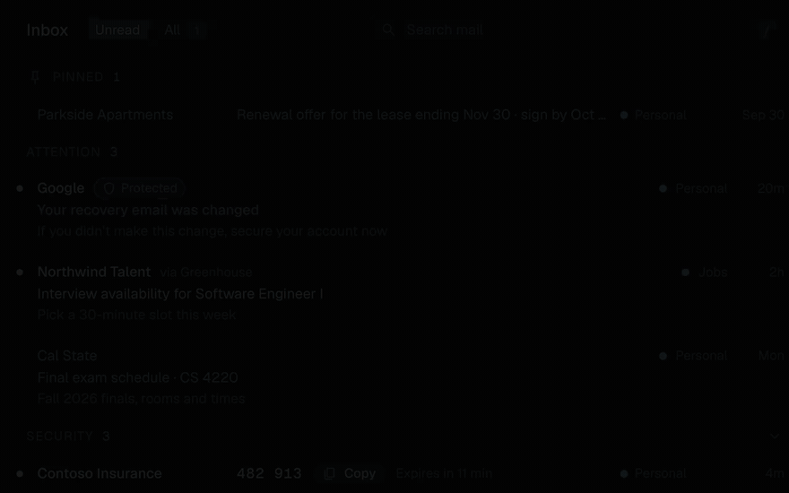
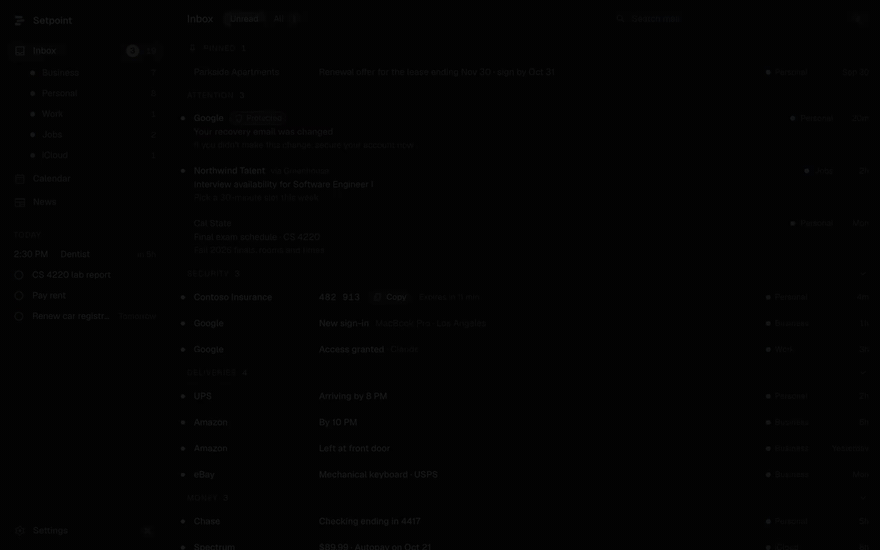
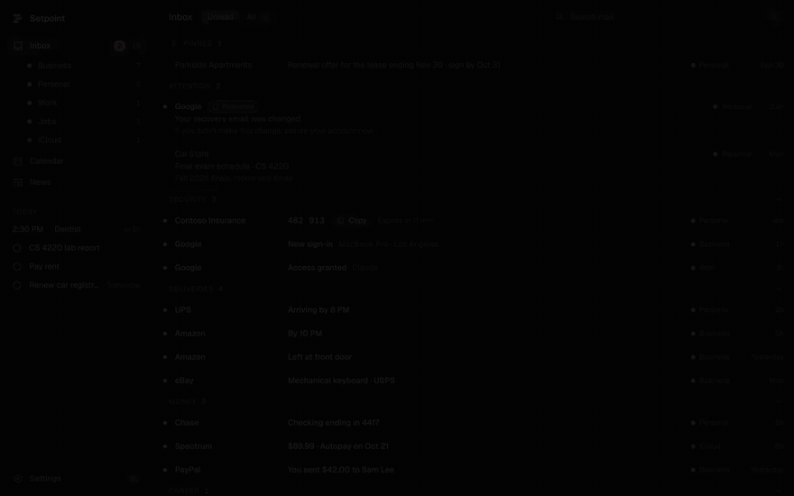
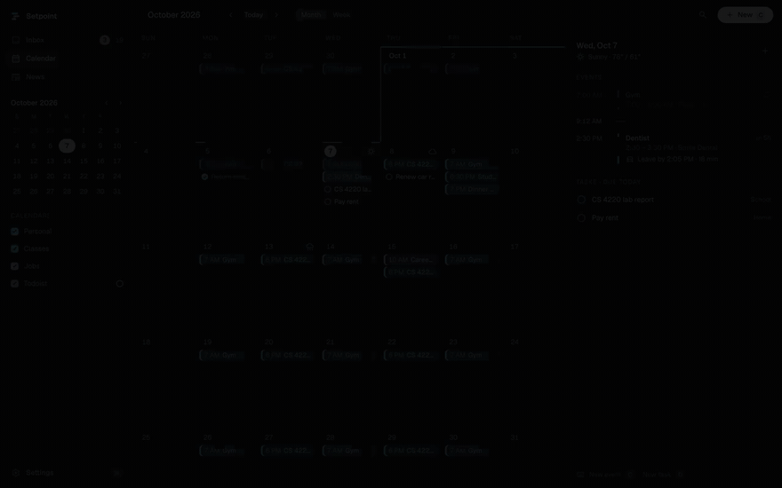
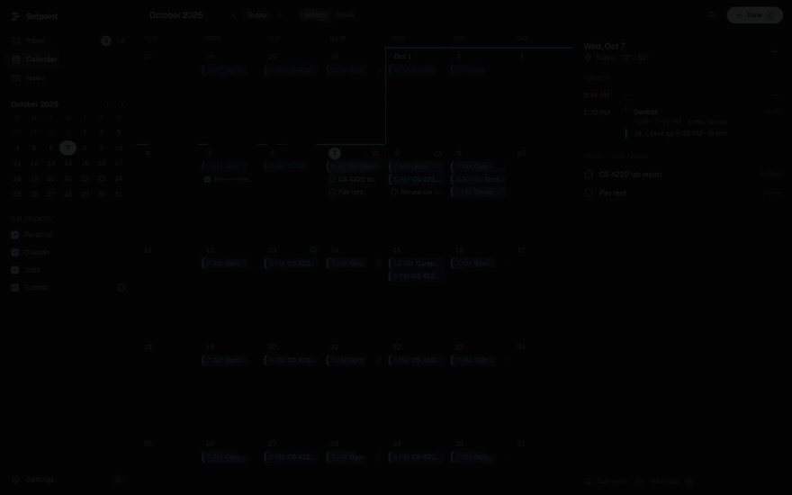
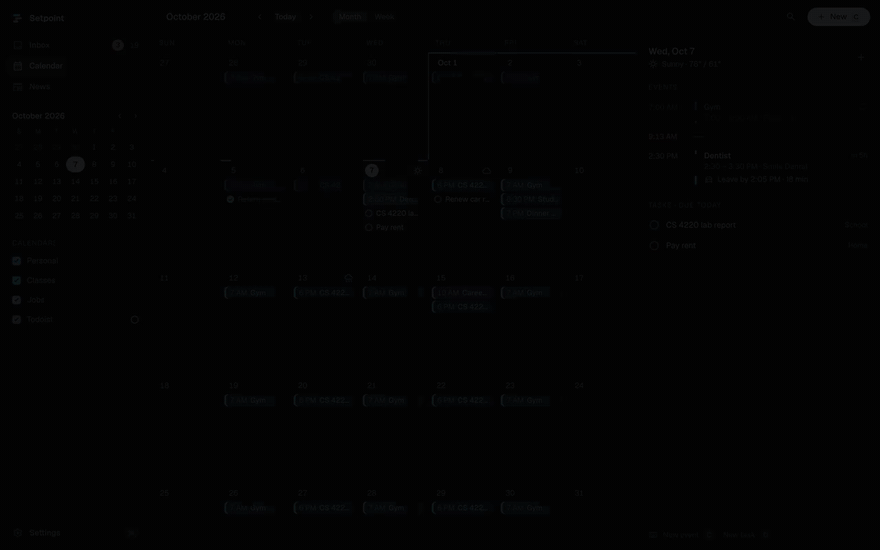
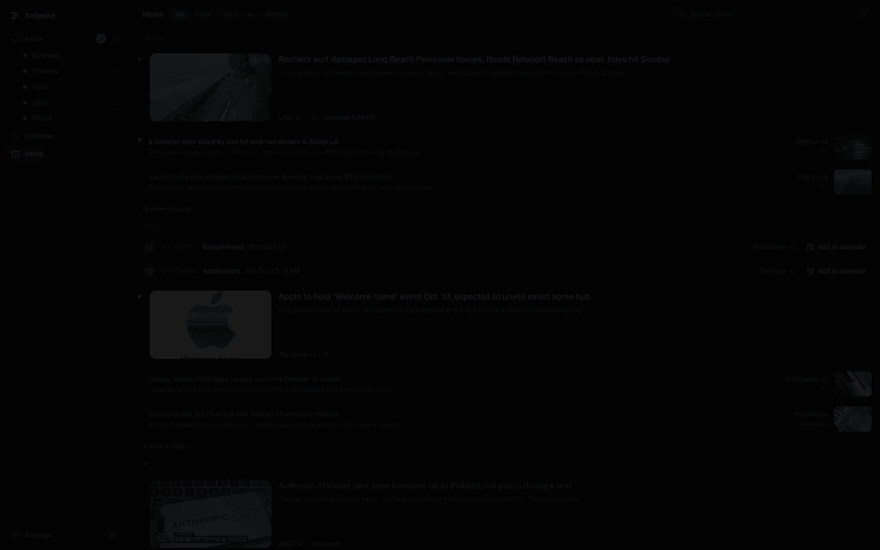
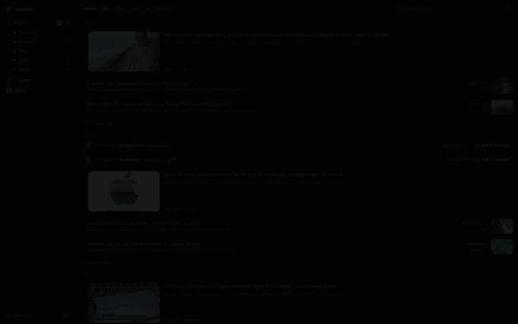
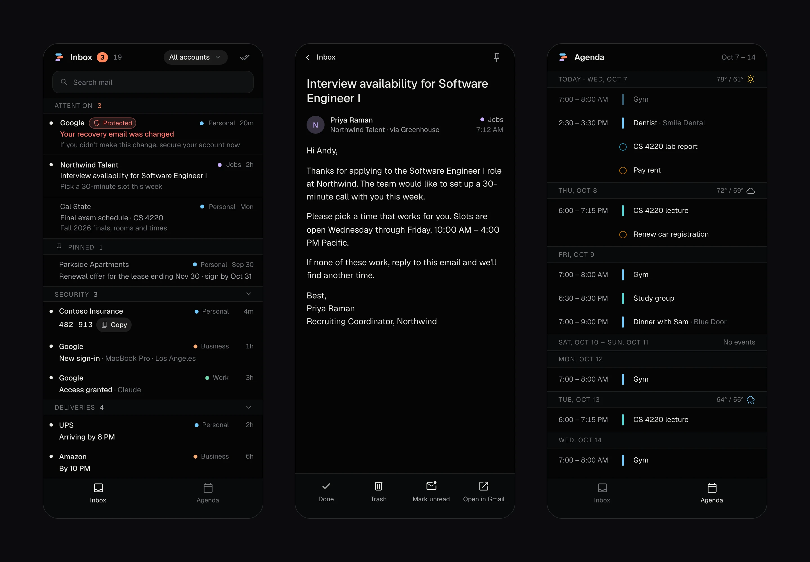

# Setpoint

One inbox, my calendar and the day's news, sorted so catching up takes seconds.

Setpoint is my private workspace for mail and time: every email account in one inbox, my calendar
with Todoist tasks, and the day's biggest stories. It's built for one person, runs in one
container, and is used from a desktop browser, with a lighter layout for the phone.

> [!NOTE]
> This is Setpoint's second version, rebuilt from the ground up. The first is deprecated and
> archived at [ansidian/setpoint-classic](https://github.com/ansidian/setpoint-classic).

## What it does

**Alfred answers from my mail, with its source.** Ask a question in search and ⌘Enter asks Alfred.
The answer names the email it came from, one click away, and takes follow-ups.

**Add to calendar, pre-filled from the email.** An email about an event becomes a proposal: the
title, time and place picked out, and whether that time is free. Nothing is added until I create it.

**One detail card glides between events.** Clicking from event to event moves the same card, with
the place, when to leave and the reminder.

**A new event from one typed line.** The day, time and place are picked out as they're typed, the
place is looked up, and conflicts show before it's created.

**A repeating event asks which ones to move.** Drag one occurrence and choose this event, this and
following, or all of them, as in Google Calendar.

**Eight outlets, one story.** News reads free sources, groups the articles about the same event
into one story, writes one summary with its sources, and shows what's new since I last looked.
Stories are ranked biggest first, and the small ones never show.

**A keynote from the news, added to the calendar.** Upcoming events in the news can go straight to
the calendar's editor, pre-filled.

**The phone layout: Inbox, reader, agenda.**

## Stack

TypeScript throughout, as npm workspaces: `shared` (the contract, Zod schemas and API types),
`server` (Node, Hono, SQLite with Drizzle, IMAP and the Google and Todoist APIs) and `web` (React
and Vite). Claude sorts mail and News and answers as Alfred.

Tests: `npm test` runs lint, typecheck and Vitest; `npm run test:browser` runs Playwright checks
against approved screenshots.

## License

[MIT](LICENSE)
